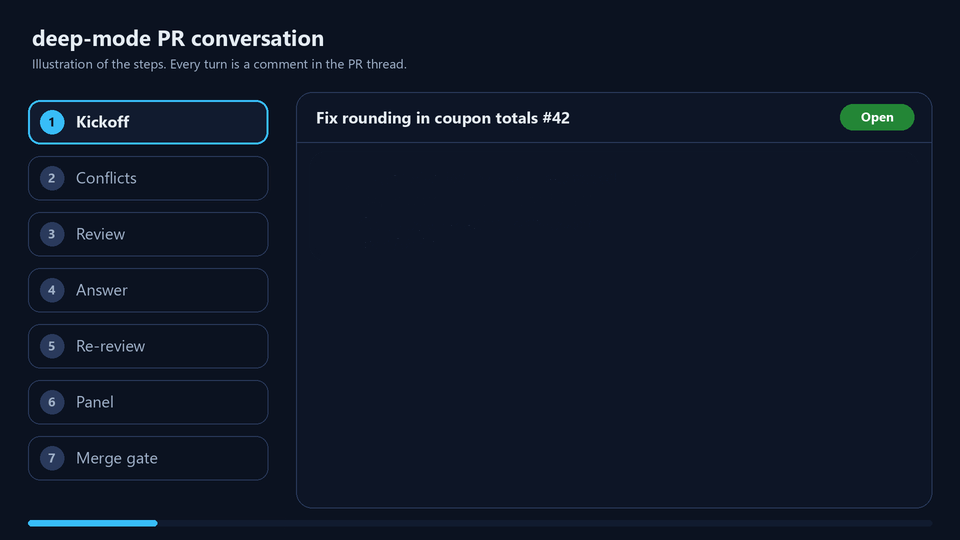

# deep-mode

**deep-mode** is an open-source AI code review GitHub App and a set of rigor skills for coding agents, in one MIT plugin. It is one replacement for Greptile, CodeRabbit, pstack and Matt Pocock's software-factory skills. Its bots review, fix, verify and merge your GitHub PRs and plan and build your issues, in the thread, as your own `<app>[bot]`. They are any ACP agent through acpx: omp by default, or Claude Code, Codex, Gemini CLI and others. They run on your machine with your own Claude.ai, ChatGPT or other subscription logins, not API keys, and you can white-label them with one flag.

It also replaces GitHub Actions: checks, reviews, security audits, overlap comments, and roadmap syncs are run by your own agent on your own subscription.

The skill itself, with the `/poteto` command, its playbooks and its PR review loop, runs in omp, Claude Code, Codex, Cursor and other harnesses. Built for the Ai Cyber community; anyone can use and improve it.

**Site:** [timothyvang.github.io/deep-mode](https://timothyvang.github.io/deep-mode/) · **Docs:** [how the bots work](plugins/deep-mode/skills/deep-mode/references/techniques/github-app.md) · [white-label](docs/white-label.md)




deep-mode is adapted from [pstack](https://github.com/cursor/plugins/tree/main/pstack) by Lauren Tan (MIT). Her idea is "if you want to go fast, go deep first": agents prove their work instead of claiming it.

## What you get

| Piece | What it does |
|---|---|
| `/poteto <anything>` | The one command. It reads your request and the repo, routes it (fix, feature, review a PR, drive a kanban board, chart a big effort, grill a plan, contribute to a project, set up a project for helpers, start a new app and pick its stack), sizes it (fast path for small jobs, full playbook for big ones), proves the result on the real app, lands it on a 3-agent panel pass, and reports what it decided. |
| `deep-mode` skill | 26 playbooks (bug fix, feature, board, wayfinder, factory, perf, refactor, prototype, babysit, shipping, autopilot, and more), 24 principles, and 31 techniques, including the verdict panel, grill, coworkers, prior-art search (GitHub, package registries, docs) before building, a security audit of each PR run by your agent, bots that talk out PRs and issues in the thread, and PR-Agent run locally on the subscription your omp is logged into (Claude or Codex). |
| `create-verification-skill` | Builds a per-repo `verify-<app>` skill: a control CLI plus a feature map, so agents can drive your app and capture proof. |
| `maintain-verification-skill` | Keeps that verify skill accurate as the app changes. |
| `rasmic-stack` skill | Ras Mic's stack picks and the philosophy behind them: 57 cited decision rules from 166 of his videos. For web and SaaS apps it uses his exact picks. For any other app (CLI, desktop, mobile, AI agent, data/ML, security tooling) it applies his rules, labels those picks **inferred**, prototypes the risky ones, and writes a cited `STACK.md`. It also carries his UI design workflow and rstack software factory. |
| PR review | `/deep-mode:review-pr <PR number>` reviews a PR with your own agent and parallel reviewer subagents, keeps only findings a code read or run proves, posts one comment-only GitHub review (on your own repo without asking), and re-reviews new commits until clean. Agents also self-review before opening a PR. No outside review service; code stays where the agent runs. |
| Land a PR | `/deep-mode:land-pr <PR number>` finishes and merges your own PR with no human: a reviewer bot posts findings in the PR thread, the author bot answers each with a fix or a reason, three verifier bots vote on the final head, and on a pass it merges. The bots are ACP agents talking through acpx: omp by default, or Claude Code, Codex and others. Where the branch requires an approving review, it admin-merges only on your standing yes (`autonomousMerge` in `~/.config/deep-mode/bot.json` or the base branch's `.deep-mode.json`), and never over a failing check. Every bot runs on your own subscription logins; no API keys. |
| GitHub App bots | Install your own private app on your repos and a poller on your machine runs those bots for you: it reviews and lands your own PRs, resolves their merge conflicts, and plans and builds the issues you open. See below. |
| `project-brief` (maintainer) | Publishes a project for contributors: a newcomer brief (`docs/PROJECT_BRIEF.md`), small claimable tasks as GitHub Issues, a generated `ROADMAP.md`, PR and issue templates, `CONTRIBUTING.md`, and two scripts the agent runs (no GitHub Actions): one comments when PRs touch the same files, one regenerates the roadmap. |
| `contribute` (contributor) | `/deep-mode:contribute <what you'd like to work on>` briefs a newcomer's agent on the project, finds an unclaimed task that doesn't overlap open PRs or other claims, claims it, builds and proves it through deep-mode, and opens a PR that closes the issue. |
| Trending catalog | `scripts/trending.py` collects new and trending repos (GitHub Trending, GitHub search for new fast risers and agent topics like skills and MCP, and githubawesome.com), enriches them with stars, license, and language, and writes a categorized digest to `references/trending/`. Before building anything, deep-mode searches it, refreshing it first when it is over a day old, so newer projects can beat the idea it already knows. |

The agent works on its own: it makes product and design calls, commits, pushes, opens PRs, keeps a kanban board, and merges. A task is done, and a PR merges, only when a panel of three skeptical verifier agents runs it and at least two agree, with evidence the agent has checked. Parallel agents talk to each other directly, like coworkers. It still asks you before deploys, deleting things it didn't create, rewriting shared history, messaging people outside the repo, spending money, or using secrets only you have.

## Install

### omp

```bash
omp plugin marketplace add TimothyVang/deep-mode
omp plugin install deep-mode@deep-mode
```

Then, in any repo:

```text
/deep-mode:poteto <your task>
```

Plugin commands are prefixed with the plugin name. For a bare `/poteto`, copy `plugins/deep-mode/commands/poteto.md` to `~/.omp/agent/commands/`.

Optional: append `agents-snippet.md` to `~/.omp/agent/AGENTS.md`. It routes large or risky work to deep-mode and sets the verification rule for every session.

### Claude Code

```text
/plugin marketplace add TimothyVang/deep-mode
/plugin install deep-mode@deep-mode
```

The skills name omp tools (`task`, `todo`, `ask`). Claude Code's equivalents are `Agent`, `TodoWrite`, and `AskUserQuestion`.

### Manual

Copy every folder in `plugins/deep-mode/skills/` to `~/.omp/agent/skills/` (or `~/.claude/skills/`), and the files in `plugins/deep-mode/commands/` to your commands folder. Codex, Cursor and other harnesses that load `SKILL.md` skills take the same folders in their own skills folder.

## Use it

```text
/poteto the coupon total is wrong. fix it
/poteto add CSV export to the reports page
/poteto review PR 42
/poteto what can I work on in this project?
/poteto set this project up so other people can contribute
/poteto start a new app: a CLI that converts Sigma rules for our SIEM
/poteto check on PR 42, and ship it when it's green
```

- You never pick a skill or playbook. `/poteto` routes, sizes, and runs it.
- Small jobs take the fast path. Big ones get the full playbook, subagents, and a decision log.
- It decides and acts without asking: commits, pushes, PRs, board cards, and merges after a panel pass. It asks once at the end only for hard stops (deploys, deletions, shared-history rewrites, outside messages, money, secrets), and lists every decision it made so you can reverse any.
- On a new repo, medium and large jobs first build a `verify-<app>` skill so the agent can prove changes. Later runs reuse it.
- The direct commands still work: `/deep-mode:review-pr`, `/deep-mode:land-pr`, `/deep-mode:contribute`, `/deep-mode:project-brief`.

## GitHub App (autonomous bots)

Like a hosted review bot, but it runs on your machine and your subscriptions. A private GitHub App you create gives the bots their own name in threads (`<app>[bot]`). The bots are any ACP agent reached through [acpx](https://github.com/openclaw/acpx): omp by default, or Claude Code, Codex, Gemini CLI, Cursor, Copilot, OpenCode and others. Each harness uses its own subscription login. No API keys, no webhooks, no server; the bot polls.

Install in three commands:

```bash
git clone https://github.com/TimothyVang/deep-mode
cd deep-mode/plugins/deep-mode/skills/deep-mode
py -3 assets/github-app/install.py      # python3 on macOS and Linux
```

`install.py` checks git, `gh`, openssl and npm, installs acpx when it is missing, finds the ACP agents on your PATH (omp first, then Claude Code, Codex, Gemini CLI, Cursor, Copilot, OpenCode), registers omp with acpx, sends a test prompt over ACP to the agents the bots will use, creates your private app in the browser, waits while you install it on the repos you pick, writes `~/.config/deep-mode/bot.json`, and registers autostart (Task Scheduler, launchd, systemd or cron). It asks before each change. `--yes` accepts every default; `--check` changes nothing; `--brand <name>` white-labels it.


Installing the app on a repo is the opt-in. Then:

```bash
py -3 assets/github-app/bot.py status
py -3 assets/github-app/bot.py once --repo <owner/repo> --dry-run   # preview a cycle, post nothing
py -3 assets/github-app/bot.py watch                                # poll in the foreground instead
```

- **Your PRs:** the bots merge in the base when it conflicts, review, fix or dismiss each finding, run a 3-verifier panel, and merge once required checks are green.
- **Others' PRs:** review comments only. They never merge.
- **Issues:** the bots plan and critique in the thread. On an issue you opened, or after you comment `@deep-mode implement`, they build it and open a PR that closes it.
- **Agents and models:** each role in `bot.json` is `{"agent": "omp", "model": "<optional>"}`. Put the author on a Claude model and the reviewer on a GPT model in omp, and one harness gives you cross-family review.
- **Opt out:** a base-branch `.deep-mode.json` with `"bot": false` skips the repo, and `"autonomousMerge": false` stops it at merge-ready.
- **White-label:** `install.py --brand acme-review` renames the app, comments, mention, branches and paths. See [docs/white-label.md](docs/white-label.md).


Details: [the github-app technique](plugins/deep-mode/skills/deep-mode/references/techniques/github-app.md).

## How it compares

deep-mode covers several tools' jobs in one MIT plugin. Cells for the other tools mark only what is well known; a dash means not claimed here, not that the tool lacks it.

| Capability | deep-mode | Greptile | CodeRabbit | pstack | Matt Pocock skills |
|---|---|---|---|---|---|
| AI PR review in the thread | Yes, as your app's [bot] | Yes | Yes | — | — |
| Bots fix their own findings | Yes, on your PRs: fix or dismiss each with proof | — | — | — | — |
| Autonomous merge after a verifier panel | Yes: 3 verifiers, 2 PASS, then a code gate | — | — | — | — |
| Merge-conflict resolution | Yes: merges base into head, no force-push | — | — | — | — |
| Issue to plan to PR | Yes: plan and critique in the thread; builds your issues | — | — | — | Partly: skills for the flow, run in your agent |
| Rigorous agent playbooks | Yes, adapted from pstack (poteto-mode), MIT, credited | — | — | Yes, the origin | Yes (e.g. TDD, grilling) |
| Software factory, board, spec to tickets to implement | Factory and board playbooks; works alongside Matt Pocock's skills | — | — | — | Yes |
| Runs on your Claude or ChatGPT subscription | Yes, no API key | Their plan | Their plan | In Cursor | In your agent |
| Self-hosted on your machine | Yes: a poller, no server, no webhooks | Hosted service | Hosted service | Runs in your editor | Runs in your agent |
| Harness and agent agnostic | Any ACP agent via acpx, omp by default; the skill runs in omp, Claude Code, Codex, Cursor | — | — | Cursor plugin | Agent skills |
| White-label | Yes, one `brand.json` | — | — | MIT, forkable | MIT, forkable |
| Price | Free, MIT; uses subscriptions you have | Paid plans | Paid plans | Free, MIT | Free, MIT |

"Their plan" means the vendor's own pricing and models. pstack and Matt Pocock's skills are skill packs, not GitHub Apps.

## Collaborate on a project

Maintainer, once per project (and again when it changes):

```text
/deep-mode:project-brief
```

Contributor, after installing the plugin:

```text
/deep-mode:contribute I know Python and want to help with detections
```

- **Claims:** a contributor's agent posts a claim comment on the issue (who, plan, files, expiry in 7 days). Other agents read claims and skip claimed work.
- **Overlap check:** before starting and before opening a PR, the agent compares its files with every open PR and active claim. On overlap it picks other work, coordinates on the issue, or builds on top. After opening the PR it runs `scripts/pr-overlap.py comment` so the PR carries an overlap comment; the maintainer's agent re-runs it on open PRs.
- **Limits:** claims are a convention, not a lock. The overlap check catches shared files, not logic conflicts in different files; local checks, review, and the panel catch those.
- **Review:** the maintainer reviews each PR with `/deep-mode:review-pr <PR number>`; contributors' agents self-review before opening one.

## Trending catalog

`plugins/deep-mode/skills/deep-mode/scripts/trending.py` keeps `references/trending/` current with no scheduler: `find <terms>` runs `update` first when the catalog is over a day old (about a minute; uses `GITHUB_TOKEN`, `GH_TOKEN`, or `gh auth token`), and `find --no-refresh` skips that. `catalog.json` keeps every repo seen in the last 120 days with first-seen date and star growth; `README.md` is the digest agents read. Commit a refreshed catalog when you want the repo copy current for other installs. To add a source, write a `source_*` function in `trending.py` and list it in `SOURCES`; to watch another GitHub topic, add it to `WATCH_TOPICS`.

## Contribute

See [CONTRIBUTING.md](CONTRIBUTING.md). Short version: branch, edit, run `python scripts/check.py` (there is no CI, so this is the gate), open a PR.

## FAQ

**Is there an open-source alternative to Greptile or CodeRabbit that uses my Claude or ChatGPT subscription?** Yes. deep-mode is MIT-licensed. Its GitHub App bots review PRs in the thread, and the models run in agent CLIs logged in with your own subscriptions. A poller on your machine does the work; nothing runs on a hosted service.

**Is deep-mode a Greptile or CodeRabbit alternative?** For AI review in the PR thread, yes. It also fixes its own findings, runs a three-agent verifier panel, and merges your own PRs behind a code-enforced gate. Greptile and CodeRabbit are hosted services on paid plans; deep-mode is self-hosted and uses your agent logins.

**How do Claude Code and Codex review each other's PRs?** Each runs as an ACP agent through acpx, with a session per PR. A coordinator passes each turn from the author to the reviewer and back and posts it to the thread, until no P0 or P1 is open. omp can fill both seats on different model families.

**Can I white-label an AI code review GitHub App?** Yes. `install.py --brand acme-review`, or `"name"` in `brand.json` in a fork, renames the app, comment author and signature, mention, branches, opt-out file, config directory and autostart task.

**Does it need an API key?** No. The agents are CLIs logged in with your subscriptions. Every call counts against that subscription's usage.

**How does deep-mode relate to pstack and Matt Pocock's skills?** deep-mode is adapted from pstack (poteto-mode) by Lauren Tan, MIT, and credits it. Its grill technique and wayfinder playbook come from Matt Pocock's skills, MIT. Its factory and board playbooks cover the spec to tickets to merged PRs flow, and it works alongside Matt Pocock's skills.

**Which agents work?** Any agent acpx reaches over ACP: omp by default, or Claude Code, Codex, Gemini CLI, Cursor, Copilot, OpenCode and others. Each role can pick its own model.

## License

MIT. See [LICENSE](LICENSE). Portions are derived from pstack, Copyright (c) 2026 Lauren Tan, and from Matt Pocock's skills (the `grill` technique and `wayfinder` playbook, MIT; notice in `plugins/deep-mode/skills/deep-mode/LICENSE`). Vendored references under `plugins/deep-mode/skills/rasmic-stack/references/` keep their own licenses: `unslop` (MIT, Lauren Tan), `before-and-after` (PolyForm Shield 1.0.0, James Clements).
