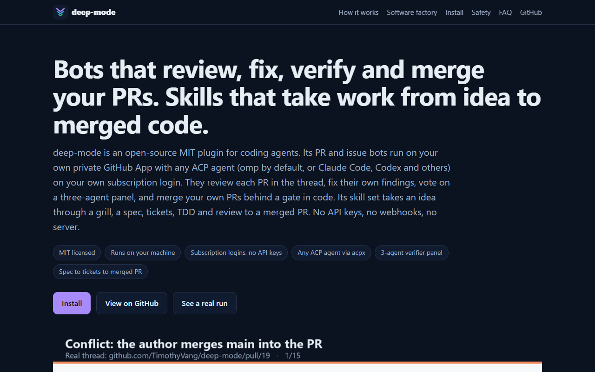
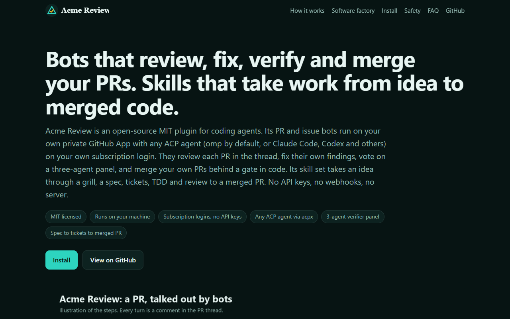

# Rebrand deep-mode as your own product

deep-mode is MIT licensed. You can take it, put your name and logo on it, and sell or ship it as your own product, the way an agency resells a dashboard under its own brand. The brand kit does the work. You write one brand file, run one command, and get a complete copy of the repo under your brand: the product name, logo, colors, commands, skills, the bot and its GitHub App, the docs site, the README, the images, and the SEO files.

<!-- screenshots -->
| | deep-mode | The Acme Review example |
|---|---|---|
| Logo |  |  |
| Site |  |  |

Both sites come from the same source. The right one is the output of `py -3 scripts/whitelabel.py --brand brand/examples/acme.json --out <dir>`, with no hand edits.
<!-- /screenshots -->

## What changes

- **Names everywhere.** Every file and path. The plugin, the marketplace entries, the `/deep` command, the `deep-mode` and `deep-stack` skills, `/deep-mode:review-pr` and the other namespaced commands, the environment variables (`DEEP_MODE_*`), the config and cache folders, the bot's branch prefix and repo config file, and the prose that names the product.
- **The bot.** The runtime `brand.json` beside `install.py` gets your slug, homepage and trigger. Your GitHub App is named `<slug>-<login>`, and its comments are signed by your slug.
- **The site.** `docs/index.html` gets your colors (light and dark), your logo in the nav, your favicon, your title and description, your Open Graph and Twitter tags, and your JSON-LD (product name, author, description). `llms.txt`, `llms-full.txt`, `robots.txt` and `sitemap.xml` point at your homepage.
- **The images.** `og.png`, the three diagrams and `install.gif` are re-rendered in your name and colors. The upstream shows captures of its own real runs; your copy has made none yet, so it claims none. In place of the upstream's PR thread it shows `how-it-works.gif`, an illustrated PR conversation drawn in your brand. `install.gif` plays the installer check as example output: `<login>` stands where the upstream's recording named an account, and the captions call it an example. Claims about the upstream's own merged PR are removed.
- **Links.** Links to the upstream repo, its site and its author point at your repo, your homepage and you.

## What stays

- **License notices.** Every `LICENSE*` and `NOTICE*` file keeps its exact bytes, because the MIT license requires the copyright and permission notice in every copy. The root `LICENSE` and `NOTICE.md` get one addition at the end: your copyright line for the rebrand. `NOTICE.md` also maps its upstream paths to your renamed ones.
- **Behavior.** The gates, the verifier panel, the agents, the playbooks and the skills work the same. Only names, colors and images change.
- **Companion repos.** A few references cite the upstream author's other repos (frontend, cloud-devsecops, softwarefactory). They point at your account after the build, so fork those repos too or drop the references.

## The brand file

Start from `brand/brand.json` (deep-mode's own brand) or `brand/examples/acme.json` (a complete fictional reseller). Every field is required. `logo` and `favicon` are paths relative to the brand file.

| Field | deep-mode | Acme Review | What it sets |
|---|---|---|---|
| `name` | `deep-mode` | `Acme Review` | The product name in titles, headings, the og image and prose |
| `displayName` | `Deep mode` | `Acme Review` | The name where text capitalizes it, like the start of a sentence |
| `slug` | `deep-mode` | `acme-review` | Plugin, marketplace, folders, bot name, branch prefix, config folders. 1 to 23 lowercase letters, digits or hyphens |
| `commandName` | `deep` | `acme` | The one command: `/acme` |
| `mainSkillName` | `deep-mode` | `acme-review` | The main skill and its folder |
| `stackSkillName` | `deep-stack` | `acme-stack` | The stack skill and its folder |
| `envPrefix` | `DEEP_MODE` | `ACME_REVIEW` | Environment variables, like `ACME_REVIEW_CONFIG_DIR` |
| `botTrigger` | `/deep-mode` | `/acme-review` | What people type in a thread to call the bot |
| `tagline` | | | The site title and the og image |
| `description` | | | Meta and social descriptions, JSON-LD, the plugin and marketplace |
| `author` | | | `{"name", "url"}`: the site author, JSON-LD, manifests, your copyright line |
| `homepage` | | | Where you host the site; canonical URLs, sitemap, robots, llms files, the GitHub App's homepage |
| `repo` | `TimothyVang/deep-mode` | `acme-co/acme-review` | `owner/name` of your GitHub repo; every repo link and install command |
| `supportUrl` | | | The site's Support link |
| `colors` | | | `primary` (buttons and links on light), `accent` (on dark, and highlights), `background`, `surface`, `text`, `muted` (the dark palette of the site and every image) |
| `logo` | `logo.svg` | `acme-logo.svg` | An SVG mark plus wordmark for the nav and README |
| `favicon` | `favicon.svg` | `acme-favicon.svg` | An SVG mark for the browser tab |

A logo that should read on light and dark pages can switch its wordmark color with `@media (prefers-color-scheme:dark)` inside the SVG, as both example logos do.

## Build

You need Python 3.10 or newer, Pillow (`py -3 -m pip install pillow`), and [agg](https://github.com/asciinema/agg) and [gifski](https://gif.ski) on your PATH for the images. It runs on Windows, macOS and Linux.

```bash
py -3 scripts/whitelabel.py --brand brand/examples/acme.json --out ../acme-review   # python3 on macOS and Linux
```

The build:

1. Copies every file. It replaces deep-mode's names with yours in text and in paths, longest name first, so `/deep-mode:deep`, `deep-stack` and `/deep` each get the right replacement.
2. Writes your brand file, logo and favicon into `brand/` and the site, and updates the plugin, marketplace and bot manifests. The README shows `brand/logo.svg` at the top, and the site's nav shows `docs/images/logo.svg`.
3. Rethemes the site, rewrites its SEO tags and JSON-LD, and rebuilds `llms-full.txt`.
4. Re-renders the images with `scripts/media/render.py`.
5. Verifies. It fails if `deep-mode`, `deep mode`, `DEEP_MODE` or the upstream author's name is left anywhere, in any case and in any path, outside `LICENSE*` and `NOTICE*`. Then it runs the copy's own `scripts/check.py`.

It prints `OK: built ../acme-review, 0 leftovers` on success. `--out` must be outside this repo (or under its `.scratch/`). Each run rebuilds the folder from scratch and keeps its `.git`, so the same inputs give the same copy. The build marks its output with `brand/.whitelabel-build` and only empties a folder that has that file, so it refuses a non-empty folder it did not build and deletes nothing there. `--brand` can be the built copy's own `brand/brand.json`.

Open `docs/index.html` in the built copy to see your site.

## Publish your plugin and marketplace

1. Create the repo named in `repo` and push the built copy to it:

   ```bash
   cd ../acme-review
   git init -b main && git add -A && git commit -m "Acme Review"
   gh repo create acme-co/acme-review --public --source . --push
   ```

2. Your users install it the same way, under your names. In omp: `omp plugin marketplace add acme-co/acme-review` then `omp plugin install acme-review@acme-review`. In Claude Code: `/plugin marketplace add acme-co/acme-review` and `/plugin install acme-review@acme-review`. In Codex: `codex plugin marketplace add acme-co/acme-review` and `codex plugin add acme-review@acme-review`. Then `/acme-review:acme <task>` runs it.
3. Serve `docs/` at your `homepage`. On GitHub Pages: Settings, Pages, deploy from the `main` branch and the `/docs` folder. For a custom domain, add a `docs/CNAME` file.

To pick up upstream changes later, pull them into your clone of the upstream repo, rebuild into the same `--out`, review the diff, and push.

## Create your own GitHub App

The bots post as your own private GitHub App. In the built copy, run the installer from the main skill's folder:

```bash
cd plugins/acme-review/skills/acme-review
py -3 assets/github-app/install.py --check   # report what is missing, change nothing
py -3 assets/github-app/install.py           # create the app and set up the bots
```

It creates the app in your browser as `<slug>-<login>` (for example `acme-review-octocat`), with your homepage and description. Comments post as `acme-review-octocat[bot]`, signed by role. Issue branches are `acme-review/issue-<n>`, the repo config file is `.acme-review.json`, the private key stays in `~/.config/acme-review/`, and people call the bot with `/acme-review`. Each person who runs the bots creates their own app, so no keys are shared.

`install.py --brand <name>` is a shortcut that renames only the bots in an existing copy. It leaves the product name, commands, skills, site and images alone. Use the brand kit for a full rebrand.

## Images

`scripts/media/` holds the generators. `render.py --brand <file> --root <copy>` renders `og.png`, `how-it-works.svg`, `pr-conversation.svg`, `issue-flow.svg`, `install.gif` (from `install.cast`, with agg) and `how-it-works.gif` (frames drawn with Pillow, encoded with gifski). The build runs it for you. To show a recording of your own installer instead of the example output, run `py -3 scripts/media/capture_install.py` in the built copy, then `py -3 scripts/media/render.py`, and reword the two captions in `README.md` and `docs/index.html`. A rebuild writes the example again.

`og.png` is drawn with Pillow: your name, tagline and colors, as text and shapes. Your logo is an SVG, which Pillow cannot draw, so the card does not include it.
