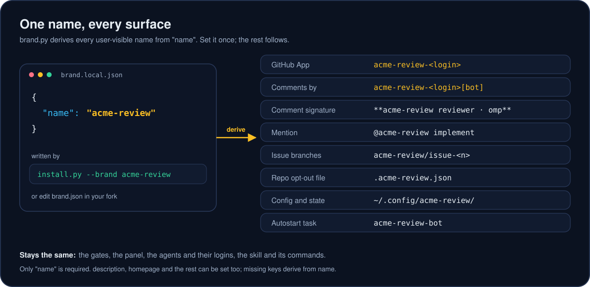

# White-label the deep-mode bots

The bots ship as **deep-mode**. You can run them under your own name. Every name a user or a repo sees comes from one file, read by `brand.py`. Set one key, `name`, and the rest is derived from it.



## Two ways to rebrand

**One flag, no fork.** From `plugins/deep-mode/skills/deep-mode/`:

```bash
py -3 assets/github-app/install.py --brand acme-review --homepage https://example.com/acme-review
```

This writes `assets/github-app/brand.local.json` and finishes setup under the new name. The name must be 1 to 23 lowercase letters, digits or hyphens, which leaves room for `-<your login>` in GitHub's 34-character app name limit. `--homepage` is optional; it is the URL shown on the GitHub App page.

**Fork and edit.** In your fork, edit `plugins/deep-mode/skills/deep-mode/assets/github-app/brand.json`. A one-key file is a complete brand:

```json
{"name": "acme-review"}
```

`brand.py` reads the first of these that exists: the file named by the `DEEP_MODE_BRAND_FILE` environment variable, then `brand.local.json`, then `brand.json`.

## Fields

Only `name` is required. Any field you set wins over the derived value.

| Field | Derived from `name` | Where it shows |
|---|---|---|
| `name` | (required) | The GitHub App is `<name>-<login>`, so comments come from `<name>-<login>[bot]`. Comment signatures read `**<name> <role> · <agent>**`. |
| `description` | `<name> bots: review, fix, verify and merge in the PR and issue threads.` | The GitHub App's description. |
| `homepage` | `https://github.com/TimothyVang/deep-mode` | The GitHub App's homepage link. |
| `mention` | `@<name>` | The word people type in a thread to call the bots, as in `@<name> implement`. |
| `branchPrefix` | `<name>` | Issue branches `<name>/issue-<n>` and fetched PR refs. |
| `repoConfigFile` | `.<name>.json` | The base-branch file that opts a repo out (`"bot": false`) or stops merges (`"autonomousMerge": false`). |
| `configDirName` | `<name>` | `~/.config/<name>/` (app key, `bot.json`, state) and `~/.cache/<name>/bot/` (clones, logs, transcripts). |
| `autostartId` | `<name>-bot` | The Task Scheduler task, launchd label, systemd unit or cron marker that starts the poller. |

## What stays the same

- The skill, its playbooks and its commands keep the deep-mode name.
- The behavior: the PR and issue conversations, the three-agent panel, the merge gate, and every safety rule.
- The agents and their logins. The bots still run ACP agents through acpx on your own subscriptions.
- The environment variable names `DEEP_MODE_BRAND_FILE` and `DEEP_MODE_CONFIG_DIR`.

## Switching an existing install

A new name means a new GitHub App, a new config directory and a new autostart entry. The old ones are left alone. To move over:

1. `py -3 assets/github-app/bot.py uninstall-autostart` under the old brand, before you change it.
2. Rebrand with `install.py --brand <name>` and install the new app on your repos.
3. Uninstall the old app from your repos in GitHub's settings, so two bots don't answer the same thread.
4. Rename any base-branch `.deep-mode.json` files to the new `repoConfigFile` name.

## How the docs images were made

The diagrams are hand-written SVG. The PR walk-through is drawn frame by frame with Pillow and encoded with [gifski](https://github.com/ImageOptim/gifski). The install recording is a real `install.py --check` run, captured line by line with timestamps into an asciicast (`images/install.cast`) and rendered with [agg](https://github.com/asciinema/agg).
